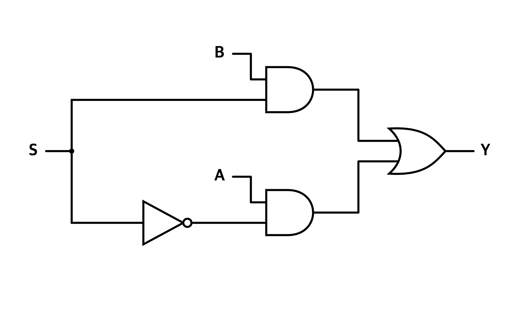
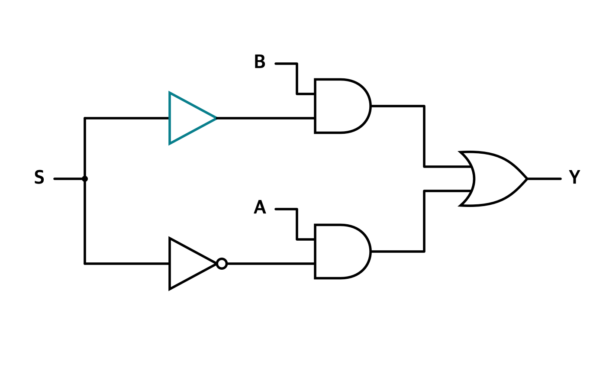
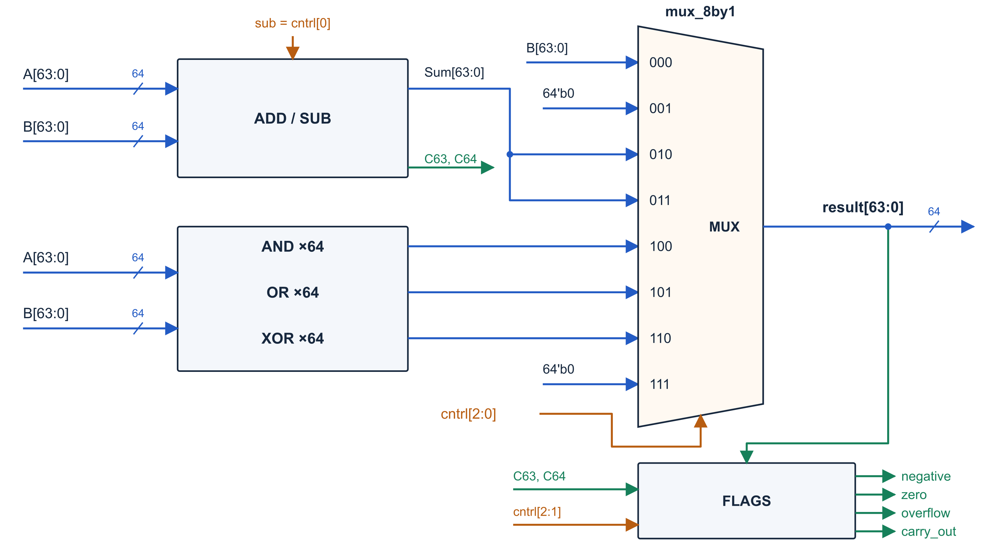
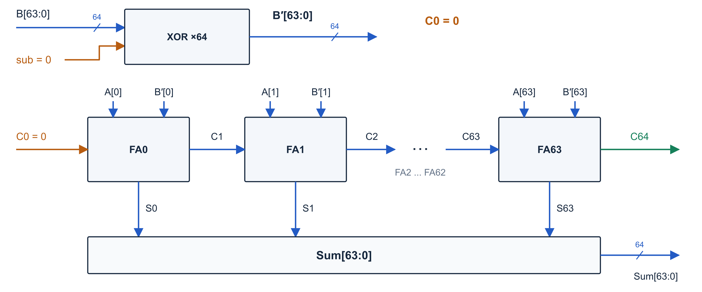
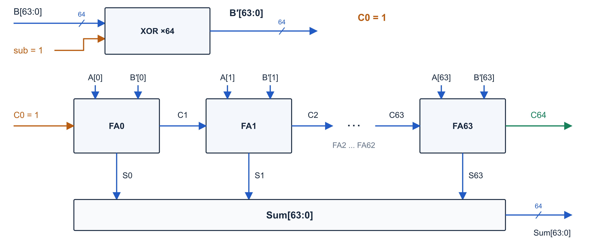
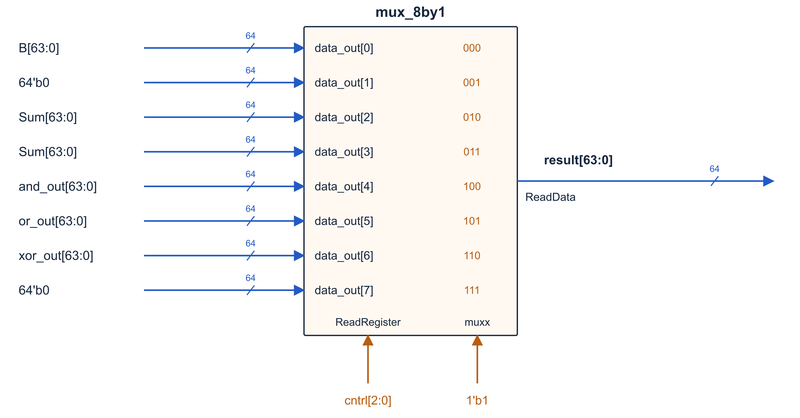

# Lab 2

## Fixed

### Hazard

Based on feedback about hazards in Lab 1 demo, buffer gates were added to the 8-to-1 and 32-to-1 multiplexers to balance the propagation delays of the address-selection paths and reduce glitches.

**Before**



**After**



## Implementation

### ALU

`alu.sv` connects the operations, selects the result, and produces the four flags. The steps below describe the signal flow through the combinational circuit.

1. **Compute the operation results.** Generate the candidate results in parallel, using `cntrl[0]` to choose addition or subtraction in the shared adder.
2. **Select the output.** The existing `mux_8by1` uses the three-bit `cntrl` code to select the operation result shown below.
3. **Generate the flags.** Take `negative` from the result's sign bit and detect whether all result bits are zero for `zero`. Forward the adder's `overflow` and `carry_out` for ADD/SUB; set these two flags to zero for other operations.

| `cntrl` | Operation | Result |
|---|---|---|
| `000` | PASS B | B |
| `010` | ADD | A + B |
| `011` | SUBTRACT | A - B |
| `100` | AND | Bitwise AND of A and B |
| `101` | OR | Bitwise OR of A and B |
| `110` | XOR | Bitwise XOR of A and B |

The unused codes `001` and `111` select zero.



#### Full Adder

First, describe the required behavior in Python: add three one-bit inputs, keep the low bit as `sum`, and pass the upper bit to the next position as `carry_out`.

```python
def full_adder(a, b, carry_in):
    total = a + b + carry_in

    sum_bit = total % 2       # Bit kept at the current position.
    carry_out = total // 2    # Bit carried to the next position.

    return sum_bit, carry_out
```

For example, `1 + 1 + 1 = 3`, or binary `11`, so both `sum_bit` and `carry_out` are `1`.

Next, choose gates that produce the same outputs. `total % 2` is 1 when an odd number of inputs are 1, which gives the XOR expression for `sum`. `total // 2` is 1 when at least two inputs are 1. One AND gate per pair of inputs detects each case, and an OR gate combines them.

```text
p         = a XOR b
sum       = p XOR carry_in
carry_out = (a AND b) OR (a AND carry_in) OR (b AND carry_in)
```

This gives the two XOR gates, three AND gates, and one OR gate implemented in `full_adder.sv`.

#### Addition and Subtraction

First, describe how to reuse addition for both operations. Addition keeps B unchanged. Subtraction uses the two's complement of B: invert its bits and add 1. The pseudocode expresses the bit inversion with a condition so the gate choice can follow from that behavior.

`A` and `B` are nonempty binary strings of the same length. The index `i` starts at `len(A) - 1`, so the rightmost bit is processed first. Each iteration decreases `i` by 1, and `break` ends the loop when `i` becomes negative.

```python
def add_sub(A, B, sub=0):
    carry = sub
    result = ""
    i = len(A) - 1

    while True:
        a = int(A[i])
        b = int(B[i])

        if sub == 1:
            b = 1 - b        # Change 0 to 1, or 1 to 0.

        carry_in = carry
        sum_bit, carry = full_adder(a, b, carry_in)

        result = str(sum_bit) + result

        i -= 1
        if i < 0:
            break

    # The final iteration processes the sign bit.
    overflow = int(carry_in != carry)

    return result, carry, overflow
```

The final carry becomes `carry_out`. For subtraction, `carry_out = 1` means no borrow was needed. Signed overflow occurs when the carries entering and leaving the sign bit differ.

These four-bit examples keep the calculation easy to follow. The implemented circuit uses 64 bits.

```python
add_sub("0101", "0010", sub=0)
# 5 + 2 -> ("0111", 0, 0)

add_sub("0101", "0011", sub=1)
# 5 - 3 -> ("0010", 1, 0)

# Return order: result, carry_out, overflow.
```

Next, translate the conditional behavior into logic.

| `sub` | Value supplied for B | Initial carry | Operation |
|---|---|---|---|
| `0` | B unchanged | `0` | `A + B` |
| `1` | Every bit of B inverted | `1` | `A + ~B + 1`, which is `A - B` |

The condition that flips B maps to XOR with `sub`: XOR with 0 keeps a bit, and XOR with 1 flips it. Connecting `sub` to the initial carry supplies the extra `+1` for subtraction. The final comparison of the sign-bit carries also maps to XOR, which is 1 when its two inputs differ.

```text
b_add[i]  = B[i] XOR sub
carry[0]  = sub
carry_out = carry[64]
overflow  = carry[63] XOR carry[64]
```

In `add_sub.sv`, the loop is implemented as 64 full-adder instances connected from the least significant bit (bit 0) to bit 63. Each stage's `carry_out` feeds the next stage's `carry_in`, forming a ripple-carry adder. All stages exist concurrently in hardware.

**Addition**

With `sub = 0`, the XOR gates keep B unchanged and the initial carry is 0. The full-adder chain computes `A + B`.



**Subtraction**

With `sub = 1`, the XOR gates invert every bit of B and the initial carry is 1. The same full-adder chain computes `A + ~B + 1`, which is `A - B`.



#### Result Selection

The three-bit `cntrl` signal selects one of the eight MUX inputs as the 64-bit result. The ADD and SUB inputs both receive `sum` from the shared adder, while the unused inputs are connected to zero.



#### Flags

`negative` comes from the result's sign bit, and `zero` is 1 only when all result bits are 0. `overflow` and `carry_out` use the shared adder's flags for ADD/SUB and are set to 0 for other operations. The enable for these two flags is `NOT cntrl[2] AND cntrl[1]`; `cntrl[1]` passes through a buffer so it arrives together with the inverted `cntrl[2]`.
